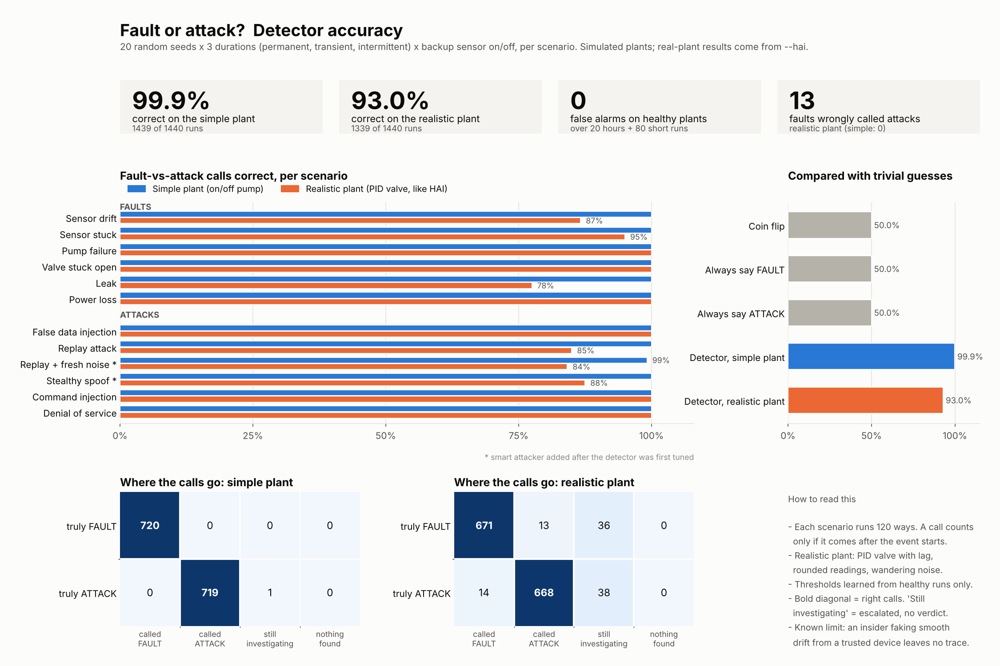

# Fault or Attack

A detector for oil and gas storage tanks that tells a **broken part** from a **cyberattack**, and explains how it decided.

Built for Hibiscus LEAP 2026 (Downstream Oil & Gas Safety, ICT Cybersecurity), Brunei.


## The idea

Faults obey physics. Attacks have to fake it.

A leak loses water at a steady rate, an ageing sensor drifts slowly, a dead pump stops. An attacker who wants to cause damage without being seen has to forge readings, and forged readings leave marks: numbers that repeat exactly, a level that falls while the pump is running, a pump that starts by itself, or commands from a computer that is not the controller.

The detector checks every reading against the tank's physics and the network, then says **FAULT** (send a technician) or **ATTACK** (call the cybersecurity team and, in Brunei, report it to BruCERT).

## Results

| Test | Result |
|---|---|
| Simple plant, 1,440 runs | 99.5% right |
| Realistic plant (PI valve) | 90.5% right |
| Normal running, 20 hours | 0 false alarms |
| Real HAI testbed data, tank attacks | 7 of 8 caught |



## Run it

You need Python 3.10 or newer.

```bash
python "FAULT OR ATTACK.py"                       # menu
python "FAULT OR ATTACK.py" --all                 # every fault and attack
python "FAULT OR ATTACK.py" --attack replay       # one attack and the detector's verdict
python "FAULT OR ATTACK.py" --fault leak          # one fault
python "FAULT OR ATTACK.py" --mystery             # live demo of a hidden scenario
```

The simulator and detector need only the standard library. For pictures and the live demo, install matplotlib:

```bash
pip install -r requirements.txt
```

## The website

`web/` is a static site with the story, two games (find the leaking pipe, then fault or attack?), the results and a topology map. Open `web/index.html` in a browser, or serve the folder:

```bash
python -m http.server 8765 --directory web
```

`web/data.js` is generated by `python "FAULT OR ATTACK.py" --web`.

## Real data (optional)

The `--hai` check uses the HAI 22.04 dataset from [github.com/icsdataset/hai](https://github.com/icsdataset/hai) (about 150 MB, not included here). Put `train1.csv`, `test1.csv` and `test2.csv` in `data/hai/`, then run:

```bash
python "FAULT OR ATTACK.py" --hai
```

## Tests

```bash
python -m unittest discover -s tests
```

The real-data test is skipped when the HAI files are not downloaded.

## Project layout

```
FAULT OR ATTACK.py     starter: menu and command-line options
fault_or_attack/       the program: plant, detector, scenarios, evaluation, plots, web export
tests/                 unit tests and saved expected outputs
web/                   the website
reports/               research reports and saved evaluation runs
research_notes/        notes behind the reports
```

## Known limit

An insider who fakes a slow, smooth drift from a device that is already trusted leaves no network trace, and physics alone cannot tell that from real sensor drift.

## Credits

Photographs on the website are shown in greyscale, which is a change to the originals. Full credits and licences are in `web/img/credits.json` and the website footer:

- "Ellwood oil storage tanks" by Dreamyshade, CC BY-SA 4.0, via Wikimedia Commons
- "Snowfall at night over Brofjorden and Preemraff oil refinery" by W.carter, CC0, via Wikimedia Commons
- "Close-up view of a red valve on a metallic pipe system with a pressure gauge in an industrial setting" by Shixart1985, CC BY 2.0, via Wikimedia Commons
- "Oil storage tanks, Slick, Oklahoma" by Russell Lee (Library of Congress), CC0, via rawpixel
- "Brunei LNG (02062022)" by DeltaSquad833, CC BY-SA 4.0, via Wikimedia Commons

HAI dataset: NSR/ETRI, [github.com/icsdataset/hai](https://github.com/icsdataset/hai).

The Brunei reporting details (BruCERT contacts, Cybersecurity Order 2023) were checked on official sites in November 2026. This is a student project, not legal advice.

## Licence

The code is under the MIT licence (see `LICENSE`). The photographs keep their own licences, listed above, and the HAI dataset keeps its own terms.
