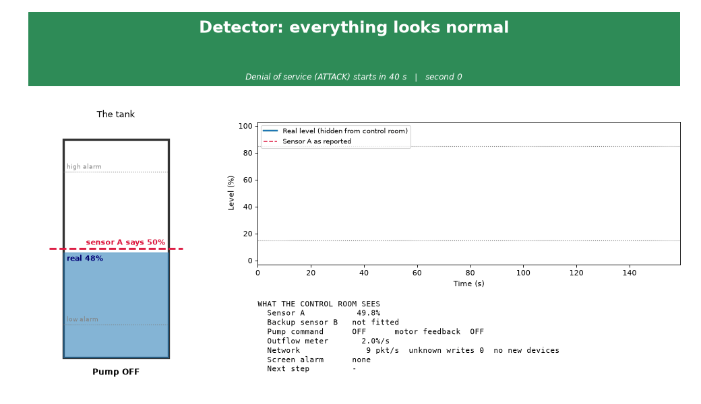

# Fault or Attack

A detector for oil and gas storage tanks that tells a **broken part** from a **cyberattack**, and explains how it decided.

Built for Hibiscus LEAP 2026 (Downstream Oil & Gas Safety, ICT Cybersecurity), Brunei.

**Try the website:** [realkint.github.io/fault-or-attack](https://realkint.github.io/fault-or-attack/)



## The idea

Faults obey physics. Attacks have to fake it.

A leak loses water at a steady rate, an ageing sensor drifts slowly, a dead pump stops. An attacker who wants to cause damage without being seen has to forge readings, and forged readings leave marks: numbers that repeat exactly, a level that falls while the pump is running, a pump that starts by itself, or commands from a computer that is not the controller.

The detector checks every reading against the tank's physics and the network, then says **FAULT** (send a technician) or **ATTACK** (call the cybersecurity team and, in Brunei, report it to BruCERT).

## Results

| Test | Result |
|---|---|
| Simple plant, 1,440 runs | 99.9% right |
| Realistic plant (PI valve) | 93.1% right |
| Normal running, 20 hours | 0 false alarms. A longer check, 120 healthy hours per plant with rain, gas-detector tests, planned visits and the daily temperature swing: 0 on the simple plant, 9 on the realistic plant (7.5 per 100 hours, all from the older replay and stuck-sensor rules) |
| Physical side: corrosion, wall thinning, water ingress, theft, tampering, drone damage, planned work (400 runs) | 400 right |
| Physical side, two events at once (280 runs) | 200 right with both causes found; the 80 misses are the two theft cases listed under Known limits |
| Smallest slow event caught every time (one-hour runs, random start) | corrosion leak or theft 0.01% of the tank per second (half a percent of normal flow), water ingress 0.005% |
| Real HAI testbed data, tank attacks | 7 of 8 caught (test day 1: 3 of 3, day 2: 4 of 5); 7 of 24 attacks overall, as most target other parts of the plant; 4 false alarms in 42 hours |


## Run it

You need Python 3.10 or newer.

```bash
python "FAULT OR ATTACK.py"                       # menu
python "FAULT OR ATTACK.py" --all                 # every fault and attack
python "FAULT OR ATTACK.py" --attack replay       # one attack and the detector's verdict
python "FAULT OR ATTACK.py" --fault leak          # one fault
python "FAULT OR ATTACK.py" --mystery             # live demo of a hidden scenario
```

The simulator and detector need only the standard library. For pictures and the live demo, install matplotlib:

```bash
pip install -r requirements.txt
```

## The website

`web/` is a static site with the story, two games (find the leaking pipe, then fault or attack?), the results and a topology map. Open `web/index.html` in a browser, or serve the folder:

```bash
python -m http.server 8765 --directory web
```

`web/data.js` is generated by `python "FAULT OR ATTACK.py" --web`.

## Real data (optional)

The `--hai` check uses the HAI 22.04 dataset from [github.com/icsdataset/hai](https://github.com/icsdataset/hai) (about 150 MB, not included here). Put `train1.csv`, `test1.csv` and `test2.csv` in `data/hai/`, then run:

```bash
python "FAULT OR ATTACK.py" --hai
```

## Tests

```bash
python -m unittest discover -s tests
```

The real-data test is skipped when the HAI files are not downloaded.

## Project layout

```
FAULT OR ATTACK.py     starter: menu and command-line options
fault_or_attack/       the program: plant, detector, scenarios, evaluation, plots, web export
tests/                 unit tests and saved expected outputs
web/                   the website
reports/               research reports and saved evaluation runs
research_notes/        notes behind the reports
```

## Stress test: an attacker who knows the detector

```bash
python "FAULT OR ATTACK.py" --stress                # simple plant
python "FAULT OR ATTACK.py" --stress --realistic    # realistic plant
```

An adaptive attacker (or AI agent) on a trusted device forges sensor A, the motor feedback and the valve position so that every networked signal agrees with physics. Without help the detector loses to it. A hard-wired witness check (backup sensor B and the high-level switch, on by default) catches it in every run before the tank overflows, when backup sensor B is fitted. `--stress` shows the result with the check off and on. Results and the risk review are in `reports/stress_consistent_forgery.txt` and the topology report.

## Physical side: corrosion, theft, tampering and damage

```bash
python "FAULT OR ATTACK.py" --physical                # simple plant
python "FAULT OR ATTACK.py" --physical --realistic    # realistic plant
```

Not every problem comes over the network. Hard-wired site signals (tamper switches, gate and badge events with work orders, the safety bypass flag, a gas detector, the bund level and a water-interface probe) let the detector give a third answer, **PHYSICAL: send site security**, for a valve forced by hand, fuel theft, an insider tampering with sensor B, a safety trip bypassed with no work order, or drone damage. A slow-balance check averages the water balance over five minutes, where sensor noise cancels out, and catches corrosion leaks and water ingress that the per-second checks miss (a leak under about 0.5% of the tank per second went unseen before). An electrical-resistance corrosion probe warns of a thinning pipe wall before anything leaks. Planned work under a work order stays a FAULT or stays silent. Results: `reports/physical_side.txt`.

```bash
python "FAULT OR ATTACK.py" --sweep         # detection curve: each slow event at a range of sizes and start times
python "FAULT OR ATTACK.py" --mixed         # two events at once
python "FAULT OR ATTACK.py" --healthy 120   # false alarms over 120 healthy hours with ordinary disturbances
```

These deeper tests (add `--realistic` for the PID plant; results in `reports/physical_deeper_tests.txt`) go beyond one size of each scenario:
- **Detection curve.** Corrosion leaks and theft are caught in every run from 0.01% of the tank per second (about 4 minutes to call), water ingress from 0.005%; nothing smaller than that is caught. A typical day's warming and cooling of the product stays well below this limit.
- **Two events at once.** A cyberattack and a theft, a network flood and a leak, a leak after sensor B has died, a drone during planned work, a leak and water ingress together: in every run the first answer was one of the true causes and both causes were reported. A physical problem found during something else is reported as a second finding beside the main verdict.
- **Healthy days.** Rain filling the bund, gas-detector tests and planned visits under a work order raised no false alarms on either plant.

The slow-balance check is the tank version of **computational pipeline monitoring (API RP 1130)**, and the `--physical` runs are the kind of simulated-leak testing **API RP 1175** asks leak detection programmes to do. The bypass verdict flags the safety-critical equipment deviations that the Petroleum Authority's **Directive No. 01/2021 (Asset Integrity Management)** requires operators to close out and report, and the detector's records can support a major-hazard **safety case** under SHENA's COMAH regulations. It is a safety net between inspections (API 510, 570 and 653), not a replacement for them.

This matches a gap regulators are now naming. Australia's 2026 independent review of its critical-infrastructure law found the regime too cyber-heavy, saying it "neglects physical security, personnel security, and all-hazards supply chain". It also asked for physical threat vectors such as drones, and OT cybersecurity, to be examined. Fault or Attack answers FAULT, ATTACK or PHYSICAL in one system.

## Known limits

Physical side, found by the deeper tests:
- **Theft under cover of a work order.** If the thief is on site legitimately (a work order is open), the theft is reported as a FAULT "slow leak", not as theft. Insider risk needs personnel security, not only sensors.
- **Theft with no access record.** Someone who climbs the fence leaves no gate or badge event, so a theft tap outside the bund looks like a slow leak outside the bund. It is still flagged within minutes and sends someone to walk the line, but as a FAULT. Perimeter sensors (fence vibration, CCTV analytics) would close this.
- **Very slow events.** Losses under about 0.01% of the tank per second (0.005% for water ingress) are not caught within an hour; daily inventory reconciliation and inspections (API 653) remain the backstop.
- **Rain plus theft.** Heavy rain raises the bund like a leak does; the detector only treats a rising bund as a leak when the gas detector also smells product, but a theft during a heavy shower has not been tested.
- **False alarms on the realistic plant.** 7.5 per 100 healthy hours, all from the older replay and stuck-sensor rules, which find natural repeats in its rounded readings. Learning those limits from 24 healthy hours instead of 3 cut this only to 5 per 100 hours, so a better test for those rules is still needed.
- **Simulator only.** All physical results come from scenarios written for this project; none has been checked against a real leak or theft.

Cyber side:

An insider who fakes a slow, smooth drift from a device that is already trusted leaves no network trace, and physics alone cannot tell that from real sensor drift.

An attacker who forges every networked signal consistently can only be caught by hard-wired witnesses (see the stress test). If they can also reach backup sensor B, nothing in this project catches them. The headline accuracy above is measured against attackers who do not adapt to the detector.

## Credits

Photographs on the website are shown in greyscale, which is a change to the originals. Full credits and licences are in `web/img/credits.json` and the website footer:

- "Ellwood oil storage tanks" by Dreamyshade, CC BY-SA 4.0, via Wikimedia Commons
- "Snowfall at night over Brofjorden and Preemraff oil refinery" by W.carter, CC0, via Wikimedia Commons
- "Close-up view of a red valve on a metallic pipe system with a pressure gauge in an industrial setting" by Shixart1985, CC BY 2.0, via Wikimedia Commons
- "Oil storage tanks, Slick, Oklahoma" by Russell Lee (Library of Congress), CC0, via rawpixel
- "Brunei LNG (02062022)" by DeltaSquad833, CC BY-SA 4.0, via Wikimedia Commons

HAI dataset: NSR/ETRI, [github.com/icsdataset/hai](https://github.com/icsdataset/hai).

The Brunei reporting details (BruCERT contacts, Cybersecurity Order 2023) were checked on official sites in November 2026. This is a student project, not legal advice.

## Licence

The code is under the MIT licence (see `LICENSE`). The photographs keep their own licences, listed above, and the HAI dataset keeps its own terms.
